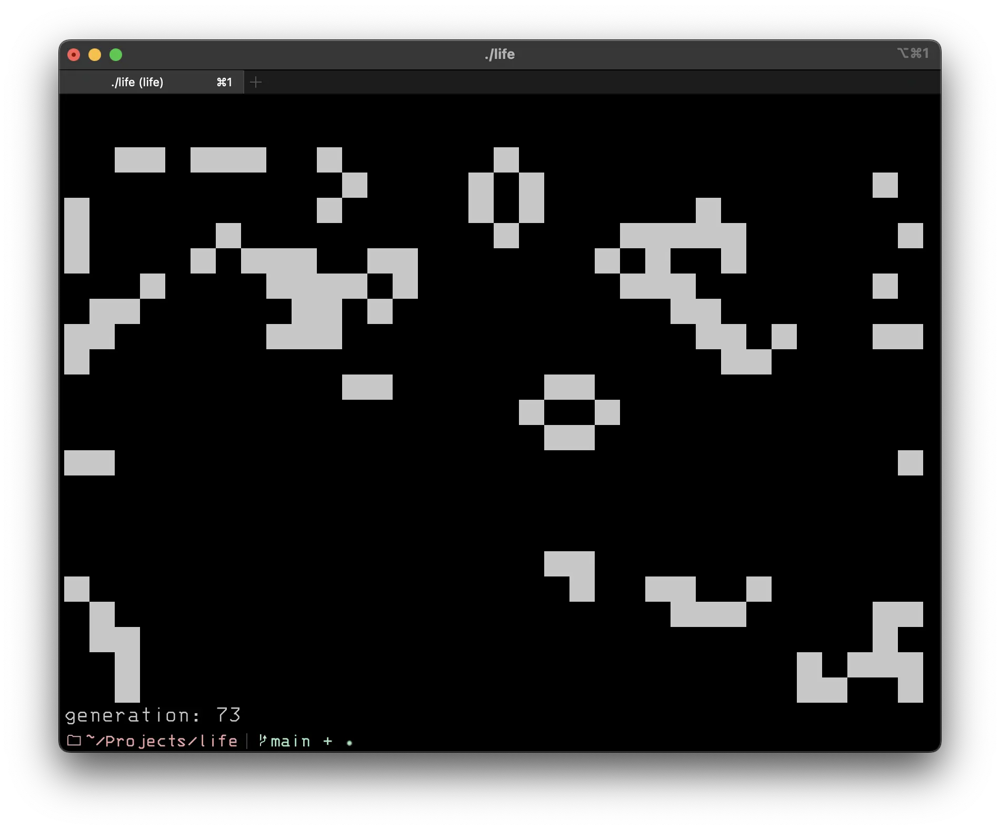

# Life

Just another Game of Life - because why not?



A terminal-based Conway's Game of Life implementation. Watch pixels live, die, and evolve right in your console.

**Caution:** May lead to existential contemplation about pixels.

## Install

```bash
go install github.com/crgimenes/life@latest
```

Or take a binary from the [releases](https://github.com/crgimenes/life/releases):
macOS and Linux (amd64 and arm64) and Windows (amd64).

## Usage

```bash
life
```

Press `^c` to quit when you've had enough of watching digital evolution unfold.

